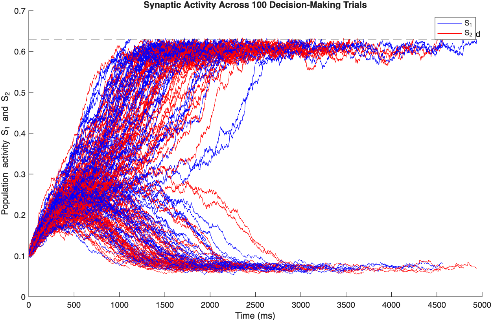
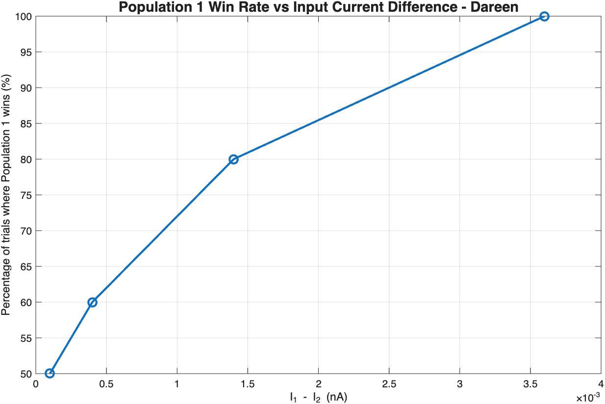
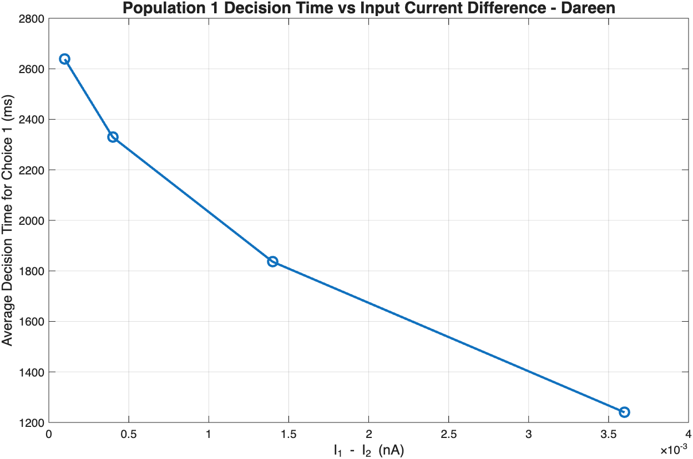
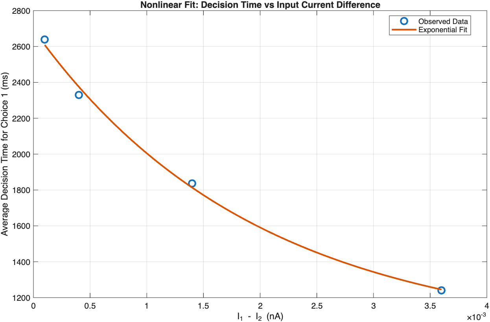
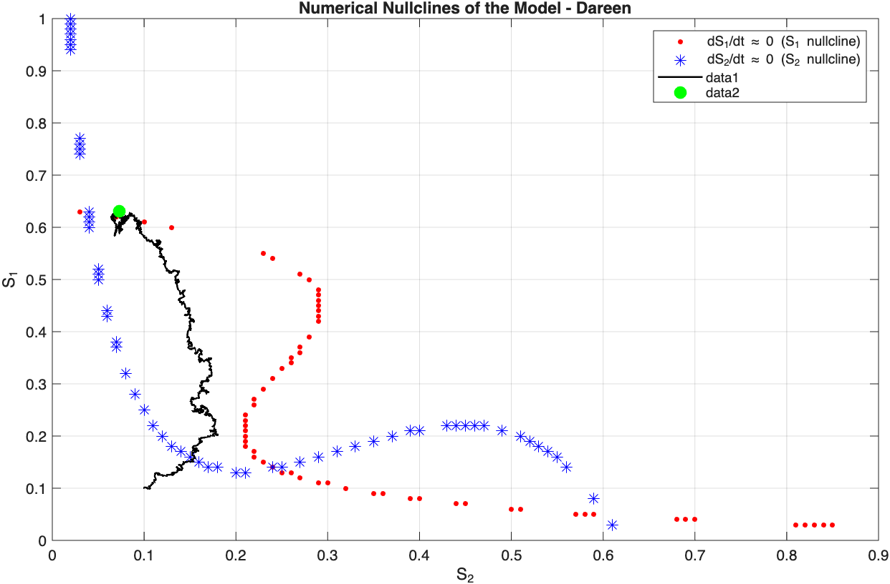
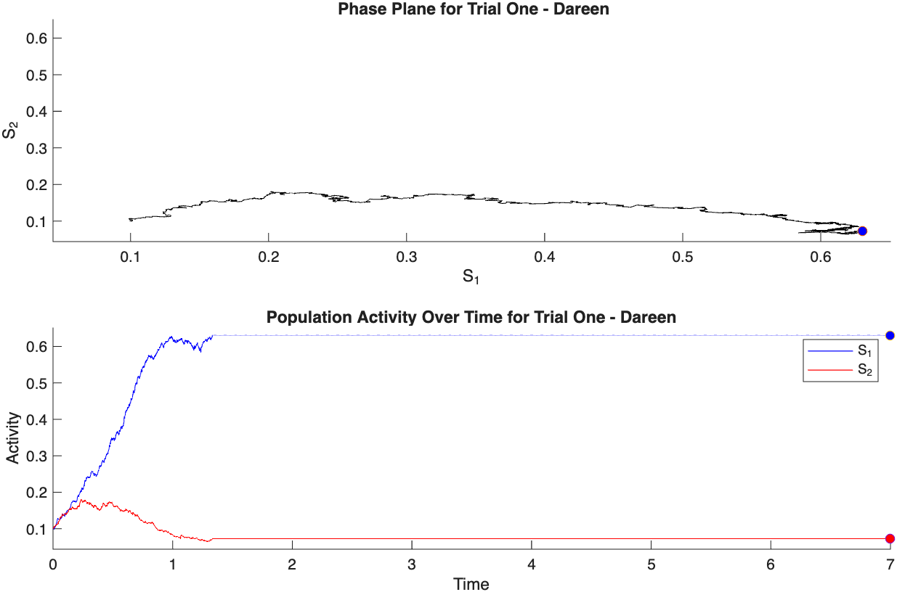

## Cortical Modelling: Neural Decision-Making Network

### Overview

This project implements a stochastic, two-population neural rate model to investigate the computational dynamics of decision-making.

The model simulates competition between two recurrently connected neural populations, incorporating self-excitation, mutual inhibition, and Gaussian noise in synaptic inputs.

Using MATLAB, I investigated how external input differences influence decision probabilities, decision times, and neural population activity. I also examined the model’s dynamical behaviour through phase-plane trajectories, numerical nullclines, and animated visualisations.

This project was originally developed as part of my MSc in Computational Cognitive Neuroscience at Goldsmiths, University of London, and received a coursework mark of 98%.

Following assessment feedback, I extended the original analysis by implementing nonlinear model fitting to explore the relationship between input bias and decision time.

## Computational Methods

**Programming language:** MATLAB

The model consists of two competing neural populations with recurrent self-excitation and mutual inhibition. Population firing rates are determined by a nonlinear input-output function, while synaptic activity evolves according to coupled differential equations.

The equations were numerically integrated using the forward Euler method with a time step of 1 ms. Independent Gaussian noise was introduced into the synaptic inputs to generate trial-to-trial variability.

### Decision-Making Simulations

The network was simulated across 100 trials per input condition.

External input currents were systematically adjusted to investigate conditions targeting approximately 50%, 60%, 80%, and 100% Population 1 decisions.

Decision outcomes were classified according to which population first crossed an activity threshold of 0.5.

### Decision-Time Analysis

Mean decision times were examined as a function of the difference between the external input currents.

An additional post-assessment analysis fitted an exponential decay function to the simulation-derived decision-time summaries using MATLAB's `fminsearch` optimisation function.

### Dynamical Systems Analysis

The model's behaviour was investigated using:

- Two-dimensional phase-plane trajectories.
- Three-dimensional plots of population activity derivatives.
- Numerical approximations of nullclines.
- Identification of candidate fixed-point regions.
- Animated visualisations of neural population activity.

## Key Findings

### Input Bias and Decision Probability

Increasing the external input favouring Population 1 increased the proportion of trials in which that population reached the decision threshold first.

By adjusting the external input currents, the model was used to investigate conditions targeting approximately 50%, 60%, 80%, and 100% Population 1 decisions.

### Input Bias and Decision Time

Greater differences between external input currents were associated with shorter mean decision times for Population 1.

An additional post-assessment analysis fitted an exponential decay function to the relationship between input current difference and mean decision time.

### Neural Population Competition

Simulated trajectories demonstrated competitive dynamics between the two neural populations. Activity in the winning population increased towards the decision threshold, while activity in the competing population was suppressed.

### Phase-Plane Dynamics

Phase-plane trajectories illustrated how the network evolved through state space during decision formation.

Numerical approximations of the nullclines were used to explore regions where the rates of change in population activity approached zero, providing insight into potential equilibrium states.

### Limitations

The model incorporates stochastic Gaussian noise, meaning that decision probabilities and decision times may vary between simulation runs.

Although the primary decision analyses use an activity threshold of 0.5, simulations terminate when either population reaches 0.63. Consequently, decision times recorded at the simulation termination threshold should be distinguished from first-crossing times at 0.5.

The nonlinear exponential fit was based on four simulation-derived summary observations and should therefore be interpreted as an exploratory, descriptive analysis rather than definitive evidence of an exponential relationship.

Numerical nullclines were approximated using a discrete state-space grid. Their intersections indicate potential equilibrium locations but do not independently establish the stability of these states.

### Project Structure

CorticalModelling.m

MATLAB script containing the neural network simulations, decision probability and decision-time analyses, nonlinear model fitting, phase-plane analysis, numerical nullcline approximations, and animated visualisations.

### figures/

Selected figures illustrating the model’s behaviour and principal findings.

### Skills Demonstrated

* MATLAB programming
* Computational modelling of neural decision-making
* Stochastic neural network simulation
* Numerical integration using the Euler method
* Dynamical systems and phase-plane analysis
* Nonlinear model fitting and optimisation
* Scientific data visualisation

## Results and Visualisations

### Neural Population Trajectories

### Input Bias and Decision Probability

### Input Bias and Decision Time

### Nonlinear Model Fitting

### Numerical Nullclines

### Phase-Plane Analysis

