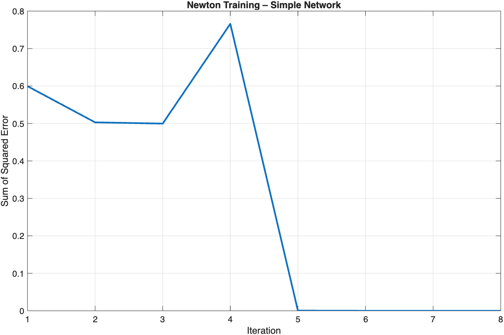
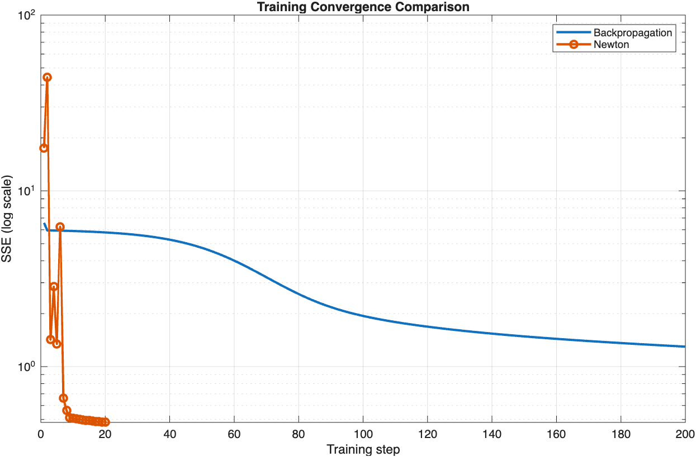

# Neural Networks Coursework 2: Newton's Method for Training Multilayer Perceptrons

## Project Overview

This project investigates the application of Newton-based optimisation to the training of multilayer perceptron (MLP) neural networks, comparing its convergence behaviour and predictive performance with conventional backpropagation.

Implemented in MATLAB as part of an MSc in Computational Cognitive Neuroscience, the project examines whether a second-order optimisation approach can improve training efficiency relative to gradient-based learning.

Two experiments were conducted:

1. **XOR validation:** Implementation and validation of a damped Gauss–Newton optimisation algorithm using a small neural network.
2. **Sunspots time-series prediction:** Comparison of conventional backpropagation and damped Gauss–Newton optimisation when training a multilayer perceptron to predict annual sunspot activity.

The project demonstrates neural network implementation, analytical Jacobian calculations, numerical optimisation and time-series forecasting.

## Neural Network Architectures

### Experiment 1: XOR Validation

A small feedforward neural network was trained to reproduce the XOR function.

The network consisted of:

- **Input layer:** 2 input units.
- **Hidden layer:** 3 sigmoid units.
- **Output layer:** 1 linear output unit.
- **Trainable parameters:** 8 connection weights.

The network used a sparse connectivity structure without bias terms.

The XOR dataset comprised four input–target pairs:

| Input 1 | Input 2 | Target |
|---------|---------|--------|
| 0 | 0 | 0 |
| 0 | 1 | 1 |
| 1 | 0 | 1 |
| 1 | 1 | 0 |

The experiment evaluated whether damped Gauss–Newton optimisation could minimise the sum of squared errors (SSE) for this nonlinear mapping.

### Experiment 2: Sunspots Time-Series Prediction

A multilayer perceptron was trained to predict annual sunspot activity using historical observations.

The network architecture consisted of:

- **Input layer:** 10 units representing the preceding ten annual observations.
- **Hidden layer:** 5 sigmoid units.
- **Output layer:** 1 linear unit predicting the subsequent observation.
- **Bias terms:** Included in the hidden and output layers.
- **Trainable parameters:** 61.

The same network architecture was used to compare the two training methods.

Historical sunspot observations were loaded from MATLAB's `sunspot.dat` dataset and normalised before training.

## Computational Methods

### Conventional Backpropagation

The first training method used conventional backpropagation with incremental gradient-based weight updates.

The implementation involved:

- Forward propagation through the network.
- Calculation of prediction errors.
- Backpropagation of error signals through the hidden layer.
- Sequential updating of connection weights.
- Monitoring training error across epochs.

The backpropagation model was trained for **200 epochs** using a learning rate of **0.01**.

### Damped Gauss–Newton Optimisation

The second training method used a damped Gauss–Newton approximation to Newton's method.

Rather than relying exclusively on first-order gradient information, this approach uses the Jacobian of network outputs with respect to the trainable parameters to construct an approximate second-order update.

The implementation involved:

- Forward propagation through the multilayer perceptron.
- Analytical calculation of the Jacobian matrix.
- Construction of a Gauss–Newton approximation to the Hessian.
- Application of a damping term to the parameter update.
- Iterative minimisation of the sum of squared errors.

The Sunspots Newton model was trained for a maximum of **20 iterations**, using a damping parameter of **0.01**.

## Results

### XOR Validation

The damped Gauss–Newton algorithm successfully trained the small neural network to reproduce the XOR mapping.

The final sum of squared errors was:

**SSE = 2.1618 × 10⁻¹⁹**

The training error approached zero within a small number of iterations, demonstrating successful optimisation of the network parameters.



*Figure 1. Sum of squared errors across iterations during Newton-based training of the XOR network.*

### Sunspots Prediction

The two training algorithms were compared using normalised mean squared error (NMSE).

| Training algorithm | NMSE |
|--------------------|------|
| Conventional backpropagation | 0.2322 |
| Damped Gauss–Newton optimisation | 0.0791 |

Damped Gauss–Newton optimisation achieved a lower NMSE than conventional backpropagation in this experiment.

The Newton-based method also reduced training error more rapidly, although the initial optimisation steps showed fluctuations in error.



*Figure 2. Training convergence of conventional backpropagation and damped Gauss–Newton optimisation for the Sunspots prediction task. The vertical axis displays SSE on a logarithmic scale.*

## Interpretation and Limitations

The findings demonstrate that damped Gauss–Newton optimisation can provide faster convergence and lower prediction error than conventional backpropagation for the network and dataset examined.

However, several limitations should be considered:

- **Computational cost:** Newton-based methods require the calculation and manipulation of Jacobian-related matrices, which may become computationally expensive as network size increases.
- **Sensitivity to optimisation settings:** Convergence can depend on initial weights, damping parameters and network architecture.
- **Limited generalisability:** The comparison was conducted using a specific network architecture and time-series dataset.
- **Training versus generalisation:** Lower training error does not necessarily establish superior predictive performance on unseen observations.

The project therefore illustrates both the potential advantages and computational trade-offs of second-order neural network optimisation.

## Project Structure

```text
NeuralNetworks-CW2/
├── CW2_main.m
├── sunspot.dat
├── README.md
└── Figures/
    ├── XOR_Newton_Convergence.png
    └── Sunspots_Training_Convergence.png
```

### Files

- [CW2_main.m](CW2_main.m) — Complete MATLAB implementation of the XOR validation and Sunspots prediction experiments, including neural network training functions.
- [sunspot.dat](sunspot.dat) — Historical sunspot observations used for time-series prediction.
- `Figures/` — Visualisations of XOR validation and training convergence.

## Running the Code

**Requirements:** MATLAB.

1. Download or clone this repository.
2. Open MATLAB.
3. Navigate to the `NeuralNetworks-CW2` directory.
4. Run:

```matlab
CW2_main
```

The script executes the XOR validation and Sunspots experiments, displays training results in the MATLAB Command Window and generates the corresponding figures.

The `sunspot.dat` file must be available in the working directory.

## Skills Demonstrated

- MATLAB programming
- Multilayer perceptron implementation
- Feedforward neural network architectures
- Backpropagation and gradient-based optimisation
- Newton and damped Gauss–Newton methods
- Analytical Jacobian computation
- Time-series prediction
- Model performance evaluation
- Numerical optimisation and convergence analysis
- Scientific visualisation and reproducible computational workflows

## Academic Context

Developed as part of the **MSc Computational Cognitive Neuroscience** programme at Goldsmiths, University of London.

The MATLAB implementation represents the original coursework project. The accompanying documentation and repository organisation were prepared for portfolio presentation.
